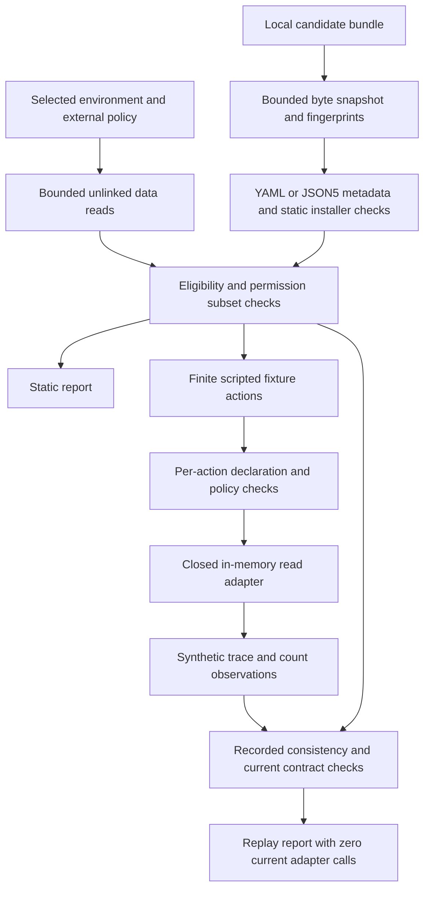

# Architecture and contribution

OpenClaw Skill CI is a Python CLI for teams reviewing versioned skill bundles
before runtime deployment. Its supported runtime is the independently accepted
M2 implementation, tool version 0.2.0 and profile `openclaw-portable-m2`. M3 adds
the asserting demo, documentation and prepared CI without changing that runtime.

## Responsibilities and authority

| Module | Responsibility |
| --- | --- |
| `cli.py` | Command arguments, output collision checks, preflight ordering and exit contracts |
| `inputs.py`, `parsing.py`, `limits.py` | Bounded unlinked reads, strict JSON/JSON5 data and typed version validation |
| `bundle.py`, `manifest.py`, `installers.py` | Candidate snapshots, canonical portable metadata and static installer declarations |
| `checks.py` | Fixture prerequisite predictions, independent policy subset and per-action checks |
| `harness.py` | Scripted synthetic log reads and counting; no candidate instruction/code interpretation |
| `json_values.py` | Recursive JSON equality with booleans distinct from numeric values |
| `replay.py` | Validate recorded coverage/counts/state/fingerprints and current contract without adapters |
| `report.py` | Console, JSON/Markdown reports and original synthetic traces |
| `scripts/demo.py` | Nine fixed real CLI subprocess cases with literal positive/negative assertions |

The candidate declares fixture intent in `skill-ci.json`; the caller selects
an independent policy. A candidate cannot grant itself wider authority. Static
declaration failures block fixture execution; every actual action is checked
again before dispatch. The only adapter reads an in-memory scenario dictionary.
No Markdown, installer, subprocess callback, plugin or model response controls
tool dispatch. Demo subprocesses run this repository's trusted CLI only.

Replay has no adapter path. It uses recorded actions, outcomes and observations;
its historical adapter count is separate from the current count of zero. It
checks internal consistency, not authenticated origin. It keeps the original
trace bytes and rejects missing evidence rather than constructing results.

## Original contribution and overlap

OpenClaw readiness commands, Agent Skills validators and ClawHub audits already
cover related problems. This repository combines a pinned portable metadata
profile, explicitly supplied dependency simulation, independently selected
fixture authority and inspectable mock/replay contracts in one offline check.
The contribution is the repeatable review workflow and honest evidence boundary,
not a new vulnerability scanner or a claim of full native conformance.

The example demonstrates a real workflow for this tool: inspect a skill, observe
four fictional records with two errors, deny undeclared access before reading,
then evaluate the recorded result under a changed expectation. It does not
measure an OpenClaw agent's instruction following or a model's performance.

## Limits and tradeoffs

[Contracts](CONTRACTS.md) documents the v1 data shapes and fixed bounds;
[M2 design](M2-DESIGN.md) gives exact portable parsing/installer restrictions.
Support files are captured as opaque bytes and explicit references are checked;
prose references are not automatically followed. Binary/environment names do
not establish versions or credential availability. Installer declarations are
not fetched, executed, licensed or security-scanned by this tool.

The in-memory adapter is not an OS sandbox. File checks reject links/reparse
points/hardlinks but do not provide a transaction against a concurrent hostile
writer. Use a stable checkout. Ordinary containers would not eliminate all risk.
Trace hashes provide fingerprints, not provenance authentication. The stricter
portable profile can reject native-valid input. Linux and hosted CI remain
unexecuted until actual runs supply evidence.

Acceptance tests and expectations live outside candidate instructions. The demo
fails on wrong exits/findings/execution labels, including an unexpected adapter
call during replay. Unit tests retain the independently accepted M1/M2 failures.
